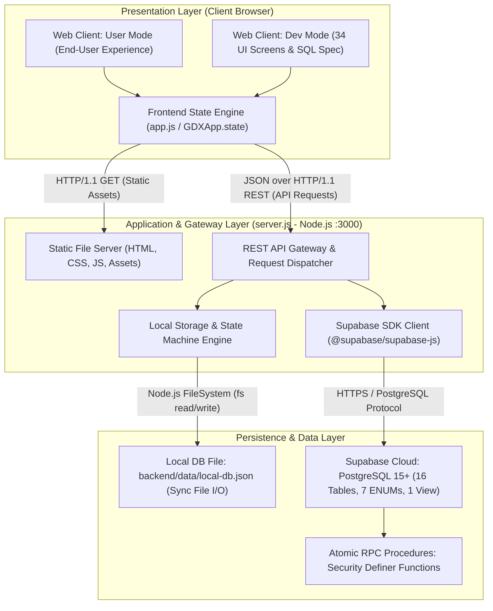

# System Architecture & Technical Overview

Tài liệu này cung cấp cái nhìn toàn cảnh về kiến trúc hệ thống, ngăn xếp công nghệ, luồng dữ liệu và các nguyên tắc kỹ thuật cốt lõi của nền tảng **Gia Đình Xanh (Home Service Booking Platform)** dành cho các kỹ sư mới gia nhập dự án.

---

## 1. Executive Summary & Core Architectural Pattern

### 1.1. Mô hình Kiến trúc Cốt lõi (Core Architectural Pattern)
Dự án được xây dựng theo mô hình **Modular Monolith & Two-Tier Architecture** (Kiến trúc 2 tầng dạng khối đơn mô-đun hóa) kết hợp với cơ chế **Hybrid Data Store** (Lớp dữ liệu lai):
* **Presentation Layer (Frontend):** Ứng dụng Single Page Application (SPA) tương tác cao, xây dựng trên nền tảng Vanilla JavaScript (ES6+), HTML5 Semantic (`<dialog>`, logical properties) và CSS Custom Properties. Frontend hỗ trợ 2 chế độ vận hành song song trên cùng một mã nguồn:
  * *Chế độ Người dùng (`user mode`):* Tối giản, thân thiện, tuân thủ nguyên tắc Warm Minimalism (dựa trên bộ kỹ năng `taste-skill` và `impeccable`).
  * *Chế độ Nhà phát triển (`dev mode`):* Hiển thị danh mục 34 UI phân theo 4 phân hệ nghiệp vụ, trực quan hóa ánh xạ 1-1 với lược đồ cơ sở dữ liệu và lời gọi hàm RPC.
* **Application & Gateway Layer (Backend):** Triển khai bằng Node.js thuần (`server.js`) sử dụng thư viện chuẩn `http` mà không phụ thuộc vào các framework bên ngoài (Zero-dependency Web Server). Đóng vai trò vừa là Static File Server cho Client, vừa là REST API Gateway cung cấp 19+ endpoints nghiệp vụ và proxy trung chuyển RPC.
* **Hybrid Data Layer (Cơ sở dữ liệu lai):**
  * *Primary Cloud Database:* Supabase Managed PostgreSQL 15+ gồm 16 bảng dữ liệu, 7 ENUMs, 1 View bảo mật (`provider_public_profiles`), 4 hàm thủ tục lưu trữ RPC kiểm toán giao dịch (Transaction Security Definer) và hệ thống chính sách Row-Level Security (RLS).
  * *Persistent Local Fallback Store:* Tệp JSON cục bộ (`backend/data/local-db.json`) được sinh và quản lý bởi mô-đun UMD `db-mock.js`, đóng vai trò là một Database Engine giả lập trong bộ nhớ có khả năng ghi bền vững (Persistence) giúp hệ thống vận hành độc lập ngay cả khi chưa cấu hình khóa API Supabase.

### 1.2. Mục tiêu Nghiệp vụ Cốt lõi (Business Objectives)
Gia Đình Xanh giải quyết bài toán kết nối theo thời gian thực và quản lý vòng đời dịch vụ chăm sóc gia đình tại chỗ (Home Service Booking) tại Việt Nam (hiện hỗ trợ các khu vực thuộc TP. Hồ Chí Minh, Hà Nội, Đà Nẵng):
1. **Khách hàng (Customer):** Tìm kiếm dịch vụ theo phân loại, cấu hình thời lượng và định vị theo Phường/Xã (`ward_id`), kiểm tra lịch rảnh của thợ (`availability_schedules`), theo dõi trạng thái đơn hàng trực tiếp (`Live Tracking`), thanh toán và đánh giá minh bạch (`reviews`).
2. **Đối tác Thợ (Provider):** Đăng ký hồ sơ xác thực danh tính (CCCD), đăng ký kỹ năng chuyên môn (`provider_services`) và khu vực nhận việc (`provider_areas`), nhận việc từ sàn công khai, ghi nhận ca làm việc thực tế (`Live Timer`), kê khai phụ phí phát sinh (`total_incidental`) và theo dõi ví thu nhập.
3. **Quản trị viên (Admin):** Điều phối vận hành đơn hàng, duyệt hồ sơ thợ (KYC Review), cấu hình bảng giá và danh mục dịch vụ, xử lý khiếu nại (`support_tickets`), điều chỉnh hóa đơn và phân quyền tài khoản (`users.is_active`).
4. **Tính trung thực & Kiểm toán:** Tuyệt đối không đưa vào các cam kết vượt ngoài phạm vi cơ sở dữ liệu; toàn bộ thay đổi trạng thái và chi phí bắt buộc phải được ghi nhận bất biến trong bảng nhật ký trạng thái (`booking_status_history`).

---

## 2. Technology Stack & Ecosystem

Bảng dưới đây tổng hợp đầy đủ ngăn xếp công nghệ được trích xuất trực tiếp từ mã nguồn thực tế và cấu hình dự án (`package.json`, `server.js`, `styles.css`):

| Phân loại | Thành phần Kỹ thuật | Phiên bản / Chi tiết Codebase | Ghi chú Kiến trúc |
| :--- | :--- | :--- | :--- |
| **Runtime & Language** | Node.js | `>= 22.0.0` (xác định tại `package.json`) | Môi trường thực thi phía Server |
| | JavaScript | ECMAScript 2022+ / CommonJS (`server.js`, `db-mock.js`) & ES Modules (`app.js`) | Ngôn ngữ phát triển toàn ngăn xếp |
| | SQL / PL/pgSQL | PostgreSQL 15+ (`supabase_rpc_functions.sql`) | Ngôn ngữ định nghĩa lược đồ và thủ tục lưu trữ |
| | HTML5 & CSS3 | Native Web Standards (CSS Variables, Logical Viewports, `:user-invalid`, Native `<dialog>`) | Không dùng Tailwind/Bootstrap; tự xây dựng Design System |
| **Web Frameworks & Core Libs** | HTTP Server | Node.js Native `http` module (`server.js`) | Không sử dụng Express, Fastify hay Koa |
| | Database SDK | `@supabase/supabase-js` v2.49.1 (`package.json`) | Client giao tiếp REST & RPC với Supabase |
| | Frontend State Management | Vanilla Reactive State Object (`GDXApp.state` trong `app.js`) | Quản lý trạng thái Client, đồng bộ qua REST APIs |
| | Charts & Data Viz | HTML5 Canvas 2D (`assets/charts.js`) | Thư viện biểu đồ thuần vẽ KPI và đường xu hướng |
| | Typography | Google Fonts: `Plus Jakarta Sans`, `Inter`, `IBM Plex Mono` | Tích hợp trực tiếp tại `index.html` và `styles.css` |
| **Database & Storage** | Primary Database | PostgreSQL 15+ (Hosted on Supabase) | 16 bảng quan hệ, 7 kiểu ENUM, 1 View, 4 hàm RPC |
| | Fallback Store | Local Persistent JSON Store (`backend/data/local-db.json`) | Động cơ lưu trữ file cục bộ tuân thủ 100% schema |
| | Caching Layer | **Not configured/Found** | Chưa tích hợp Redis/Memcached |
| | Message Queues | **Not configured/Found** | Giao dịch và cập nhật xử lý đồng bộ trực tiếp |
| **Infrastructure & CI/CD** | Containerization | **Not configured/Found** | Chưa cấu hình Dockerfile / docker-compose.yml |
| | Orchestration | **Not configured/Found** | Chưa cấu hình Kubernetes |
| | CI/CD Pipelines | **Not configured/Found** | Chưa có `.github/workflows` hay GitLab CI |
| | Codebase Tooling | Node.js Watch Mode (`node --watch server.js`), `inspect.mjs` (CDP Visual Audit) | Kiểm thử trực quan và tự động tải lại khi phát triển |

---

## 3. High-Level System Architecture (Mermaid)

Sơ đồ dưới đây mô tả luồng giao tiếp tổng thể giữa Client, Gateway Application Server, lớp xử lý nghiệp vụ/giao dịch và các kho lưu trữ dữ liệu:



### Chú thích Luồng Giao tiếp & Giao thức:
1. **Client -> Server (`HTTP/1.1 GET`):** Tải các tài nguyên tĩnh ([index.html](file:///d:/hao/hao/zzz_CHUA_PHAN_LOAI/demo%20giao%20dien-giadinhxanh%202/index.html), [styles.css](file:///d:/hao/hao/zzz_CHUA_PHAN_LOAI/demo%20giao%20dien-giadinhxanh%202/styles.css), [app.js](file:///d:/hao/hao/zzz_CHUA_PHAN_LOAI/demo%20giao%20dien-giadinhxanh%202/app.js), [assets/](file:///d:/hao/hao/zzz_CHUA_PHAN_LOAI/demo%20giao%20dien-giadinhxanh%202/assets)).
2. **Client -> API Gateway (`JSON over HTTP/1.1 REST`):**
   * Tải cấu hình và dữ liệu bootstrap (`GET /api/status`, `GET /api/bootstrap`).
   * Thực hiện các thao tác chuyển đổi trạng thái đơn hàng (`POST /api/rpc/transition-status`).
   * Cập nhật phụ phí, thanh toán, điều chỉnh đơn (`/api/rpc/*`).
3. **API Gateway -> Supabase Cloud (`HTTPS / REST / RPC`):** Kết nối qua SDK `@supabase/supabase-js` sử dụng Service Role Key hoặc Anon Key được nạp từ [.env.local](file:///d:/hao/hao/zzz_CHUA_PHAN_LOAI/demo%20giao%20dien-giadinhxanh%202/.env.local).
4. **API Gateway -> Local Fallback Store (`Native fs I/O`):** Khi chưa kết nối Supabase, hệ thống thực thi trực tiếp trên tệp JSON đồng bộ nguyên tử, tự động tính toán View và Trigger mô phỏng.

---

## 4. Repository Directory Structure

Cấu trúc phân cấp thư mục của kho lưu trữ (tối đa độ sâu 3 cấp, lược bỏ các thư mục rác và tạm):

```text
demo-giao-dien-giadinhxanh-2/
├── assets/                               # Tài nguyên đồ họa, ảnh chụp thực tế và biểu đồ
│   ├── charts.js                         # Thư viện vẽ biểu đồ Canvas 2D độc lập
│   ├── service-*.jpg                     # Hình ảnh đại diện các dịch vụ (cleaning, cooking,...)
│   └── provider-*.jpg                    # Ảnh đại diện mẫu cho đối tác thợ
├── backend/                              # Mô-đun dữ liệu lưu trữ phía máy chủ
│   └── data/
│       └── local-db.json                 # Persistent Local Database (lưu trữ 16 bảng dữ liệu dạng JSON)
├── docs/                                 # Tài liệu kiến trúc và hướng dẫn kỹ thuật
│   └── ARCHITECTURE.md                   # Tài liệu kiến trúc hệ thống (tệp hiện tại)
├── .env.example                          # Mẫu khai báo các biến môi trường cấu hình
├── .env.local                            # Biến môi trường cục bộ (Supabase URL, Anon Key, Service Key)
├── app.js                                # Mã nguồn Client SPA: Điều hướng, Render 34 UI, State & Event Handlers
├── db-mock.js                            # Seed data và Logic định nghĩa cấu trúc dữ liệu chuẩn PostgreSQL
├── DESIGN.md                             # Tài liệu quy chuẩn hệ thống thiết kế Warm Minimalism Design System
├── index.html                            # Cửa sổ khởi nhập HTML5 duy nhất (Single Page App Shell & Modals)
├── NEXTJS_APP_ROUTER_SPEC_VA_MIDDLEWARE.md # Đặc tả cấu trúc định tuyến mở rộng cho tương lai Next.js
├── package.json                          # Khai báo cấu hình dự án, lệnh chạy và phụ thuộc Node.js
├── package-lock.json                     # Khóa phiên bản chi tiết các gói thư viện
├── PRODUCT.md                            # Định nghĩa bối cảnh sản phẩm, vai trò và phạm vi nghiệp vụ
├── server.js                             # Full-stack Server: HTTP Server, Static Host & REST/RPC Gateway
├── styles.css                            # Toàn bộ CSS quy chuẩn Warm Minimalism, Animations & Layouts
├── supabase_rpc_functions.sql            # Định nghĩa 4 hàm RPC PL/pgSQL bảo mật giao dịch (Security Definer)
├── TAI_LIEU_DAC_TA_GIAO_DIEN_34_MAN_HINH.md # Đặc tả chi tiết 34 giao diện (19 Pages + 15 Modals)
└── tai_lieu_dac_ta_giao_dien_google_docs.html # Tài liệu xuất bản dạng HTML phục vụ chia sẻ tài liệu
```

### Mô tả Mục đích Kỹ thuật của các Tệp & Thư mục Trọng yếu:
* **[server.js](file:///d:/hao/hao/zzz_CHUA_PHAN_LOAI/demo%20giao%20dien-giadinhxanh%202/server.js):** Động cơ máy chủ chính (1000 dòng code). Đảm nhiệm đọc biến môi trường nóng, chuyển đổi linh hoạt giữa Supabase và Local Store, định tuyến 19+ REST API endpoints và phân phối tệp tĩnh với MIME type chính xác.
* **[app.js](file:///d:/hao/hao/zzz_CHUA_PHAN_LOAI/demo%20giao%20dien-giadinhxanh%202/app.js):** Lõi xử lý phía Client (5300+ dòng code). Chứa toàn bộ logic dựng giao diện cho 34 màn hình/hộp thoại, quản lý đồng hồ đếm giờ làm việc (`Live Timer`), bộ tính toán chi phí đặt lịch, ma trận lịch rảnh của thợ và điều khiển chuyển luồng người dùng / dev.
* **[db-mock.js](file:///d:/hao/hao/zzz_CHUA_PHAN_LOAI/demo%20giao%20dien-giadinhxanh%202/db-mock.js):** Lược đồ dữ liệu chuẩn quan hệ (800+ dòng code). Khởi tạo dữ liệu mẫu với UUID chuẩn, liên kết khóa ngoại (`foreign keys`) chặt chẽ giữa 16 bảng dữ liệu.
* **[supabase_rpc_functions.sql](file:///d:/hao/hao/zzz_CHUA_PHAN_LOAI/demo%20giao%20dien-giadinhxanh%202/supabase_rpc_functions.sql):** Bộ kịch bản SQL cài đặt trên Supabase nhằm thu hồi quyền sửa trực tiếp bảng `bookings`, ủy quyền xử lý chuyển trạng thái cho 4 hàm RPC transactional: `rpc_transition_booking_status`, `rpc_provider_update_incidental`, `rpc_customer_confirm_payment`, `rpc_admin_adjust_booking`.
* **[backend/data/local-db.json](file:///d:/hao/hao/zzz_CHUA_PHAN_LOAI/demo%20giao%20dien-giadinhxanh%202/backend/data/local-db.json):** Tệp CSDL JSON bền vững lưu giữ toàn bộ các thay đổi phát sinh trong quá trình chạy thử nghiệm (đơn hàng mới, sửa trạng thái, đánh giá).

---

## 5. Key Cross-Cutting Concerns

### 5.1. Cơ chế Xác thực & Phân quyền (Authentication & Authorization)
* **Xác thực danh tính (Authentication):**
  * *Chế độ Supabase:* Tích hợp với dịch vụ `auth.users` của Supabase qua JWT Bearer token và khóa công khai `anon_key`. Định danh người dùng thông qua hàm `auth.uid()`.
  * *Chế độ Local Mock:* Quản lý phiên làm việc qua đối tượng `db.session` với 4 định danh cố định đại diện cho các vai trò:
    * Khách hàng: `Nguyễn Minh Thảo` (`user_id`: `a0eebc99-9c0b-4ef8-bb6d-6bb9bd380a11`, `customer_id`: `101`).
    * Đối tác Thợ: `Đặng Thị Mai Lan` (`user_id`: `b1eebc99-9c0b-4ef8-bb6d-6bb9bd380b21`, `provider_id`: `201`).
    * Quản trị viên: `Nguyễn Quang Hào` (`user_id`: `c2eebc99-9c0b-4ef8-bb6d-6bb9bd380c99`, `role`: `admin`).
    * Khách vãng lai (`anon`).
* **Phân quyền truy cập (Role-Based Access Control - RBAC):**
  * Được phân định chặt chẽ bởi ENUM `user_role` (`customer`, `provider`, `admin`).
  * *Ở tầng Cơ sở dữ liệu:* Kiểm soát bằng chính sách Row-Level Security (RLS) và Ma trận máy trạng thái (Role State Machine) trong các hàm RPC `SECURITY DEFINER`. Ví dụ: Khách hàng chỉ được phép hủy đơn ở trạng thái `pending`/`confirmed`; Thợ chỉ được chuyển đơn sang `in_progress` hoặc `completed`; Admin có toàn quyền can thiệp và điều chỉnh.
  * *Ở tầng Giao diện:* Kiểm soát hiển thị động qua hàm `renderUserTopbar()` và bộ lọc quyền hạn màn hình trong `app.js`.

### 5.2. Quản lý Cấu hình & Biến môi trường (Configuration Management)
* **Bộ nạp cấu hình (Config Loader):** Triển khai tại hàm `loadEnvConfig()` trong `server.js`. Hàm này quét tuần tự các tệp `.env` và `.env.local` ở thư mục gốc để nạp cấu hình vào bộ nhớ mà không cần cài đặt thư viện bên thứ ba như `dotenv`.
* **Biến môi trường hỗ trợ:**
  * `NEXT_PUBLIC_SUPABASE_URL`: Địa chỉ máy chủ Supabase Project.
  * `NEXT_PUBLIC_SUPABASE_ANON_KEY`: Khóa công khai dùng cho truy vấn Client-side có kiểm soát RLS.
  * `SUPABASE_SERVICE_ROLE_KEY`: Khóa quản trị đặc quyền dùng phía Backend Server để vượt qua RLS khi khởi tạo hoặc đồng bộ hệ thống.
  * `PORT`: Cổng mạng máy chủ HTTP lắng nghe (mặc định: `3000`).
* **Khả năng Nạp nóng (Hot Reloading):** Server hỗ trợ tự động kiểm tra lại tệp [.env.local](file:///d:/hao/hao/zzz_CHUA_PHAN_LOAI/demo%20giao%20dien-giadinhxanh%202/.env.local) mỗi khi có yêu cầu gọi tới endpoint `GET /api/status`, giúp kỹ sư có thể điền thông tin Supabase Key mà không cần khởi động lại tiến trình Node.js.
* **Secret Manager:** **Not configured/Found** (Dự án hiện dựa trên tệp bí mật cục bộ `.env.local` được loại trừ trong `.gitignore`).

### 5.3. Ghi vết, Giám sát & Đo kiểm (Logging, Tracing & Monitoring)
* **Logging:** Sử dụng luồng chuẩn `console.log` và `console.error` của Node.js để ghi nhận các sự kiện máy chủ và lỗi yêu cầu HTTP. Chưa tích hợp các thư viện chuyên dụng như Winston, Morgan hay Pino.
* **Tracing & APM:** **Not configured/Found** (Chưa tích hợp OpenTelemetry, Jaeger, Datadog hay New Relic).
* **Kiểm tra Sức khỏe Hệ thống (Health Check & Diagnostics):**
  * Cung cấp endpoint chẩn đoán chuyên dụng `GET /api/status`.
  * Trả về chi tiết: Trạng thái kết nối Supabase, chế độ lưu trữ hiện tại (`supabase` hoặc `local_sql_store`), kiểm tra sự tồn tại của các biến môi trường, và số lượng bản ghi thực tế của 10 bảng trọng yếu (`users`, `customer_profiles`, `provider_profiles`, `services`, `bookings`, `reviews`, `support_tickets`,...).
* **Đo lường & Kiểm định Chất lượng Giao diện (Visual UI Auditing):** Tích hợp công cụ đo lường Chrome DevTools Protocol (`inspect.mjs`) thông qua lệnh `npm run inspect` để tự động hóa việc đo kiểm độ tương phản WCAG AA, kích thước typography, số dòng hiển thị tiêu đề và chụp ảnh màn hình tự động ở 3 kích thước: Desktop (`1440px`), Tablet (`768px`) và Mobile (`390px`).
