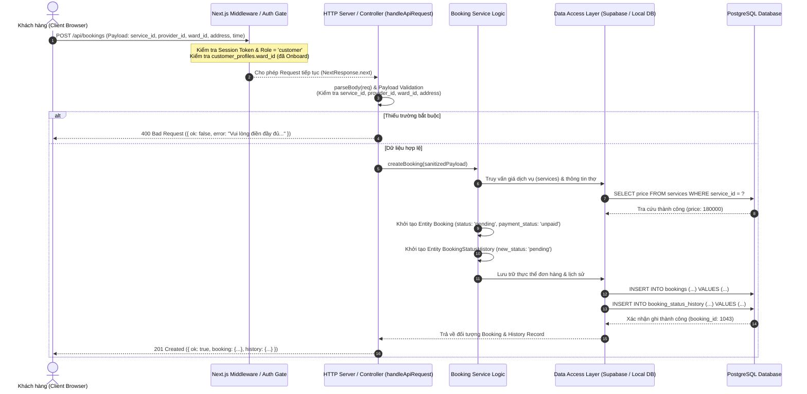

# Core Services & API Specifications

> **Dự án:** Gia Đình Xanh — Hệ thống Đặt lịch Dịch vụ Gia đình (Home Service Booking)  
> **Kiến trúc:** Node.js Backend Server + Supabase PostgreSQL SDK + Next.js App Router / Middleware Architecture  
> **Tài liệu tham chiếu mã nguồn:** `server.js`, `supabase_rpc_functions.sql`, `NEXTJS_APP_ROUTER_SPEC_VA_MIDDLEWARE.md`, `db-mock.js`, `backend/data/local-db.json`

---

## 1. Domain/Module Breakdown

### Module: System & Environment Management Service
* **Đường dẫn mã nguồn:** `server.js` (Dòng 32–94, 172–227, 266–336)
* **Trách nhiệm chính (Core Responsibility):** Quản lý nạp biến môi trường động (`.env.local`), khởi tạo và quản lý kết nối client Supabase (`@supabase/supabase-js`), giám sát trạng thái sức khỏe kết nối (Health Check) và đồng bộ dữ liệu hạt nhân (Bootstrap 16 bảng + View) giữa bộ lưu trữ cục bộ và Supabase.
* **Dependencies:**
  - `@supabase/supabase-js` (CreateClient)
  - `fs`, `path`, `http`, `url` (Node.js Native Modules)
  - `db-mock.js` (`createInitialStore()`)
  - `backend/data/local-db.json` (Local Storage Persistence Layer)
* **Public Interfaces / Methods:**
  - `loadEnvConfig(): { supabaseUrl: string, supabaseAnonKey: string, supabaseServiceKey: string, port: number }`
  - `getSupabaseClient(): { client: SupabaseClient | null, config: object, error?: string }`
  - `ensureLocalDb(): DatabaseSchema`
  - `saveLocalDb(db: DatabaseSchema): void`
  - `fetchBootstrapData(): Promise<{ mode: string, connected: boolean, supabaseUrl: string | null, data: DatabaseSchema }>`

---

### Module: Authentication & Identity Service
* **Đường dẫn mã nguồn:** `server.js` (Dòng 339–376), `NEXTJS_APP_ROUTER_SPEC_VA_MIDDLEWARE.md` (Dòng 111–224)
* **Trách nhiệm chính (Core Responsibility):** Đăng ký tài khoản người dùng mới (`users`), phân định vai trò (`customer`, `provider`, `admin`), thực thi kiểm tra tính duy nhất của số điện thoại (`phone_number UNIQUE`) và cung cấp kiểm soát truy cập phân tầng (RBAC) qua Middleware.
* **Dependencies:**
  - `server.js` (`ensureLocalDb`, `saveLocalDb`, `getSupabaseClient`)
  - PostgreSQL Table: `public.users`, `auth.users`
* **Public Interfaces / Methods:**
  - `handleRegister(payload: { full_name: string, phone_number: string, email?: string, role?: 'customer' | 'provider' }): Promise<{ ok: boolean, user?: UserRecord, error?: string }>`
  - `middleware(request: NextRequest): Promise<NextResponse>` (RBAC & Auth Verification, kiểm tra `is_active = true`, điều hướng `customer_profiles.ward_id` và `provider_profiles.verification_status`)

---

### Module: Customer Profile & Preferences Service
* **Đường dẫn mã nguồn:** `server.js` (Dòng 379–411, 441–462, 749–770)
* **Trách nhiệm chính (Core Responsibility):** Khởi tạo và cập nhật hồ sơ khách hàng (`customer_profiles`), thiết lập sổ địa chỉ mặc định theo phường/xã (`ward_id` NOT NULL), lưu trữ tọa độ định vị GPS cá nhân và quản lý danh sách dịch vụ yêu thích (`favorites`).
* **Dependencies:**
  - PostgreSQL Tables: `customer_profiles`, `users`, `favorites`, `ward`, `province`
  - Data Layer: `ensureLocalDb`, `saveLocalDb`
* **Public Interfaces / Methods:**
  - `onboardCustomer(payload: { user_id?: string, full_name?: string, phone_number?: string, default_address?: string, ward_id: string, latitude?: number, longitude?: number }): Promise<{ ok: boolean, customer_profile: CustomerProfile, user: UserRecord }>`
  - `updateCustomerProfile(payload: { customer_id: number, full_name?: string, phone_number?: string, ward_id?: string, default_address?: string, latitude?: number, longitude?: number }): Promise<{ ok: boolean, user: UserRecord, customer_profile: CustomerProfile, error?: string }>`
  - `toggleFavorite(payload: { customer_id: number, service_id: number }): Promise<{ ok: boolean, added: boolean, favorites: FavoriteItem[] }>`

---

### Module: Provider Profile & Operational Service
* **Đường dẫn mã nguồn:** `server.js` (Dòng 125–167, 414–438, 464–521, 805–843)
* **Trách nhiệm chính (Core Responsibility):** Quản lý hồ sơ nghiệp vụ đối tác thợ (`provider_profiles`), xác thực định danh CCCD (`id_card_number` UNIQUE), quản lý trạng thái trực tuyến & GPS tức thời (`is_available_online`), thiết lập danh mục chuyên môn (`provider_services`), khu vực phủ sóng (`provider_areas`), cùng lịch biểu định kỳ và lịch nghỉ ngoại lệ (`availability_schedules`, `availability_exceptions`).
* **Dependencies:**
  - PostgreSQL Tables: `provider_profiles`, `provider_services`, `provider_areas`, `availability_schedules`, `availability_exceptions`, `users`
  - PostgreSQL View: `provider_public_profiles` (Lọc ẩn CCCD, chỉ hiển thị thợ `verified` và tài khoản `is_active`)
* **Public Interfaces / Methods:**
  - `computeProviderPublicProfiles(db: DatabaseSchema): ProviderPublicProfile[]`
  - `recomputeProviderRating(db: DatabaseSchema, providerId: number): void`
  - `onboardProvider(payload: { provider_id?: number, id_card_number: string, info?: string, avatar_url?: string }): Promise<{ ok: boolean, provider_profile?: ProviderProfile, error?: string }>`
  - `updateOnlineGps(payload: { provider_id: number, is_available_online?: boolean, lattitude?: number, longtitude?: number }): Promise<{ ok: boolean, provider_profile?: ProviderProfile, error?: string }>`
  - `updateCapabilities(payload: { provider_id: number, info?: string, avatar_url?: string, service_ids?: number[], ward_ids?: string[] }): Promise<{ ok: boolean, provider_profile: ProviderProfile, provider_services: ProviderService[], provider_areas: ProviderArea[] }>`
  - `addSchedule(payload: { provider_id: number, day_of_week: number, start_time: string, end_time: string }): Promise<{ ok: boolean, schedule: ScheduleRecord }>`
  - `deleteSchedule(scheduleId: number): Promise<{ ok: boolean, deleted_schedule_id: number }>`
  - `addException(payload: { provider_id: number, exception_date: string, start_time: string, end_time: string, reason?: string }): Promise<{ ok: boolean, exception: ExceptionRecord }>`

---

### Module: Booking Management Service (Order Lifecycle)
* **Đường dẫn mã nguồn:** `server.js` (Dòng 523–574)
* **Trách nhiệm chính (Core Responsibility):** Khởi tạo đơn đặt lịch dịch vụ mới qua Booking Wizard, kiểm tra toàn vẹn dịch vụ, đối tác thợ và địa bàn hành chính, xác định đơn giá cơ sở và thiết lập bản ghi lịch sử trạng thái ban đầu (`booking_status_history`).
* **Dependencies:**
  - PostgreSQL Tables: `bookings`, `booking_status_history`, `services`, `provider_profiles`, `customer_profiles`, `ward`
  - Data Store: `ensureLocalDb`, `saveLocalDb`
* **Public Interfaces / Methods:**
  - `createBooking(payload: { service_id: number, provider_id: number, ward_id: string, customer_id?: number, address: string, scheduled_time?: string, latitude?: number, longitude?: number, total_amount?: number, notes?: string, changed_by?: string }): Promise<{ ok: boolean, booking: BookingRecord, history: BookingStatusHistoryRecord, error?: string }>`

---

### Module: Transactional RPC & Audit Log Service
* **Đường dẫn mã nguồn:** `server.js` (Dòng 576–699), `supabase_rpc_functions.sql` (Dòng 19–345)
* **Trách nhiệm chính (Core Responsibility):** Thực thi các giao dịch chuyển đổi trạng thái nguyên tử (Atomic State Machine), khóa dòng chống tương tranh (`SELECT FOR UPDATE`), cập nhật phụ phí phát sinh minh bạch, xác nhận hoàn tất thanh toán và điều phối/hoàn tiền dành cho Admin kèm ghi vết kiểm toán tự động vào `booking_status_history`.
* **Dependencies:**
  - PostgreSQL Stored Procedures: `rpc_transition_booking_status`, `rpc_update_incidental_cost`, `rpc_confirm_booking_payment`, `rpc_admin_adjust_payment_and_refund`
  - Context & Security: `auth.uid()`, `public.is_admin()`, `public.current_customer_id()`, `public.current_provider_id()`
  - PostgreSQL Tables: `bookings`, `booking_status_history`
* **Public Interfaces / Methods:**
  - `rpc_transition_booking_status(p_booking_id: number, p_new_status: BookingStatus, p_reason?: string, p_actor_id?: string): Promise<{ ok: boolean, booking: BookingRecord, history: BookingStatusHistoryRecord }>`
  - `rpc_update_incidental_cost(p_booking_id: number, p_incidental_cost: number, p_incidental_note?: string, p_actor_id?: string): Promise<{ ok: boolean, booking: BookingRecord }>`
  - `rpc_confirm_booking_payment(p_booking_id: number, p_payment_method?: string, p_actor_id?: string): Promise<{ ok: boolean, booking: BookingRecord }>`
  - `rpc_admin_adjust_payment_and_refund(p_booking_id: number, payload: { provider_id?: number, status?: BookingStatus, payment_status?: PaymentStatus, total_amount?: number, total_incidental?: number, reason: string }): Promise<{ ok: boolean, booking: BookingRecord }>`

---

### Module: Reviews & Ratings Evaluation Service
* **Đường dẫn mã nguồn:** `server.js` (Dòng 151–167, 701–746)
* **Trách nhiệm chính (Core Responsibility):** Thu thập và lưu trữ đánh giá/chấm điểm chất lượng dịch vụ của khách hàng cho đơn hàng đã hoàn tất (`completed`), áp dụng ràng buộc duy nhất một đánh giá trên một đơn hàng (`booking_id UNIQUE`), tự động kích hoạt tính toán lại chỉ số uy tín (`average_rating` & `total_reviews`) của thợ và hỗ trợ kiểm duyệt bài đánh giá.
* **Dependencies:**
  - PostgreSQL Tables: `reviews`, `bookings`, `provider_profiles`
  - Internal Trigger: `recomputeProviderRating` (Tương đương Trigger `trg_reviews_refresh_rating` trong SQL)
* **Public Interfaces / Methods:**
  - `createReview(payload: { booking_id: number, rating: number, comment?: string }): Promise<{ ok: boolean, review: ReviewRecord, provider_profile: ProviderProfile, error?: string }>`
  - `deleteReview(reviewId: number): Promise<{ ok: boolean, deleted_review_id: number, error?: string }>`
  - `recomputeProviderRating(db: DatabaseSchema, providerId: number): void`

---

### Module: Support & Incident Ticketing Service
* **Đường dẫn mã nguồn:** `server.js` (Dòng 773–802)
* **Trách nhiệm chính (Core Responsibility):** Tiếp nhận yêu cầu trợ giúp và báo cáo sự cố phát sinh từ người dùng liên quan đến đơn hàng dịch vụ hoặc sự cố tài khoản, quản lý vòng đời phiếu hỗ trợ (`open`, `in_progress`, `resolved`, `closed`) và phân cấp ưu tiên xử lý.
* **Dependencies:**
  - PostgreSQL Tables: `support_tickets`, `users`, `bookings`
* **Public Interfaces / Methods:**
  - `createSupportTicket(payload: { user_id?: string, booking_id?: number | null, subject?: string, priority?: 'low' | 'medium' | 'high' | 'urgent' }): Promise<{ ok: boolean, ticket: SupportTicketRecord }>`
  - `updateSupportTicket(ticketId: number, payload: { status?: 'open' | 'in_progress' | 'resolved' | 'closed', priority?: string }): Promise<{ ok: boolean, ticket: SupportTicketRecord, error?: string }>`

---

### Module: Administration, Catalog & Location Master Service
* **Đường dẫn mã nguồn:** `server.js` (Dòng 846–947)
* **Trách nhiệm chính (Core Responsibility):** Quản trị danh mục dịch vụ phân cấp (`service_categories`), biểu giá và dịch vụ chi tiết (`services`), thẩm định hồ sơ đối tác thợ (KYC Review), kiểm soát kích hoạt/khóa tài khoản người dùng (`is_active`), và thiết lập cây đơn vị hành chính cấp Tỉnh/Phường (`province`, `ward`).
* **Dependencies:**
  - PostgreSQL Tables: `service_categories`, `services`, `provider_profiles`, `users`, `province`, `ward`
* **Public Interfaces / Methods:**
  - `reviewProviderKyc(providerId: number, status: 'pending' | 'verified' | 'rejected'): Promise<{ ok: boolean, provider_profile: ProviderProfile, error?: string }>`
  - `toggleUserStatus(userId: string, isActive: boolean): Promise<{ ok: boolean, user: UserRecord, error?: string }>`
  - `createService(payload: { category_id?: number, title: string, description?: string, price: number, pricing_type?: 'fixed' | 'hourly' | 'custom', estimated_duration?: number }): Promise<{ ok: boolean, service: ServiceRecord }>`
  - `toggleServiceStatus(serviceId: number, isActive: boolean): Promise<{ ok: boolean, service: ServiceRecord, error?: string }>`
  - `createCategory(payload: { parent_id?: number | null, category_name: string, slug?: string, description?: string }): Promise<{ ok: boolean, category: CategoryRecord }>`
  - `toggleCategoryStatus(categoryId: number, status: boolean): Promise<{ ok: boolean, category: CategoryRecord, error?: string }>`
  - `createLocation(payload: { type: 'province' | 'ward', provinceId?: string, ward_id?: string, name: string }): Promise<{ ok: boolean, province?: ProvinceRecord, ward?: WardRecord, error?: string }>`

---

## 2. API Endpoints Catalog

| Method | Endpoint Path | Controller / Action | Auth Required? | Mô tả chức năng ngắn gọn |
|---|---|---|---|---|
| `GET` | `/api/status` | `handleApiRequest` (Status Check) | Public | Kiểm tra kết nối Supabase, biến môi trường `.env.local` và số lượng record của 16 bảng |
| `GET` | `/api/bootstrap` | `handleApiRequest` (Bootstrap Data) | Public | Trích xuất toàn bộ dữ liệu 16 bảng và View `provider_public_profiles` cho client khởi tạo |
| `POST` | `/api/supabase/reset-local` | `handleApiRequest` (Reset Seed) | Public / Dev | Khôi phục toàn bộ 16 bảng dữ liệu SQL nội bộ về trạng thái dữ liệu mẫu chuẩn |
| `POST` | `/api/auth/register` | `handleApiRequest` (Auth Register) | Public | Đăng ký tài khoản người dùng (`customer` hoặc `provider`), kiểm tra số điện thoại duy nhất |
| `POST` | `/api/onboarding/customer` | `handleApiRequest` (Customer Onboarding) | Session / Token | Khởi tạo hồ sơ khách hàng mới (bắt buộc `ward_id`), lưu địa chỉ và tọa độ GPS |
| `POST` | `/api/onboarding/provider` | `handleApiRequest` (Provider Onboarding) | Session / Token | Đăng ký hồ sơ thợ ban đầu (bắt buộc `id_card_number` CCCD duy nhất, trạng thái `pending`) |
| `PUT` | `/api/profile/customer` | `handleApiRequest` (Update Customer Profile) | Bearer (Customer) | Cập nhật thông tin cá nhân, số điện thoại, sổ địa chỉ và tọa độ GPS mặc định |
| `PATCH` | `/api/provider/online-gps` | `handleApiRequest` (Provider Online & GPS) | Bearer (Provider) | Bật/tắt trạng thái trực tuyến nhận việc (`is_available_online`) và cập nhật tọa độ GPS thợ |
| `PUT` | `/api/provider/capabilities` | `handleApiRequest` (Provider Capabilities) | Bearer (Provider) | Cập nhật hồ sơ năng lực thợ: kỹ năng (`provider_services`) và phường nhận việc (`provider_areas`) |
| `POST` | `/api/bookings` | `handleApiRequest` (Create Booking) | Bearer (Customer) | Khởi tạo đơn đặt lịch dịch vụ mới qua Wizard, tự động tạo lịch sử trạng thái `pending` |
| `POST` | `/api/rpc/transition-status` | `handleApiRequest` (RPC Transition) | Bearer (All Roles) | Chuyển đổi trạng thái đơn hàng an toàn theo State Machine và ghi vết vào `booking_status_history` |
| `POST` | `/api/rpc/update-incidental` | `handleApiRequest` (RPC Incidental Cost) | Bearer (Provider/Admin) | Thợ kê khai phụ phí vật tư phát sinh trong ca làm việc, tính lại tổng tiền `total_amount` |
| `POST` | `/api/rpc/confirm-payment` | `handleApiRequest` (RPC Confirm Payment) | Bearer (Customer/Admin) | Xác nhận khách đã thanh toán hóa đơn (`unpaid` $\rightarrow$ `paid`), chặn thanh toán đơn đã hủy |
| `POST` | `/api/rpc/admin-adjust` | `handleApiRequest` (RPC Admin Adjust) | Bearer (Admin Only) | Admin can thiệp điều phối đơn hàng, đổi thợ, thay đổi trạng thái, điều chỉnh giá hoặc hoàn tiền |
| `POST` | `/api/reviews` | `handleApiRequest` (Create Review) | Bearer (Customer) | Khách gửi chấm điểm & nhận xét cho đơn `completed`, tự động kích hoạt tính lại sao trung bình thợ |
| `DELETE` | `/api/reviews/:id` | `handleApiRequest` (Delete Review) | Bearer (Admin Only) | Quản trị viên xóa đánh giá vi phạm tiêu chuẩn và tự động tính lại điểm trung bình cho thợ |
| `POST` | `/api/favorites/toggle` | `handleApiRequest` (Toggle Favorite) | Bearer (Customer) | Thêm hoặc gỡ bỏ một dịch vụ khỏi danh sách yêu thích của khách hàng |
| `POST` | `/api/support-tickets` | `handleApiRequest` (Create Support Ticket) | Bearer (All Roles) | Khởi tạo phiếu yêu cầu hỗ trợ hoặc báo cáo sự cố khẩn cấp gắn với đơn hàng |
| `PATCH` | `/api/support-tickets/:id` | `handleApiRequest` (Update Ticket) | Bearer (Admin/Support) | Cập nhật tiến độ xử lý (`status`) và mức độ ưu tiên (`priority`) của phiếu hỗ trợ |
| `POST` | `/api/schedules` | `handleApiRequest` (Add Schedule) | Bearer (Provider) | Thiết lập khung giờ làm việc cố định trong tuần theo thứ (`day_of_week`: 0..6) |
| `DELETE` | `/api/schedules/:id` | `handleApiRequest` (Delete Schedule) | Bearer (Provider) | Xóa một khung giờ làm việc cố định của thợ |
| `POST` | `/api/exceptions` | `handleApiRequest` (Add Schedule Exception) | Bearer (Provider) | Khai báo ngày nghỉ phép hoặc ngoại lệ lịch làm việc (`exception_date`) |
| `PATCH` | `/api/admin/kyc/:id` | `handleApiRequest` (Review Provider KYC) | Bearer (Admin Only) | Duyệt hồ sơ hành nghề thợ: cập nhật `verification_status` (`verified` / `rejected`) |
| `PATCH` | `/api/admin/users/:id` | `handleApiRequest` (Toggle User Active) | Bearer (Admin Only) | Khóa hoặc mở khóa tài khoản người dùng hệ thống (`is_active: boolean`) |
| `POST` | `/api/admin/services` | `handleApiRequest` (Create Service) | Bearer (Admin Only) | Thêm dịch vụ mới vào danh mục cùng giá cố định/giờ và thời lượng ước tính |
| `PATCH` | `/api/admin/services/:id` | `handleApiRequest` (Toggle Service Active)| Bearer (Admin Only) | Bật/tắt trạng thái mở bán của dịch vụ (`is_active: boolean`) |
| `POST` | `/api/admin/categories` | `handleApiRequest` (Create Category) | Bearer (Admin Only) | Tạo mới phân loại danh mục dịch vụ (hỗ trợ phân cấp cha - con qua `parent_id`) |
| `PATCH` | `/api/admin/categories/:id` | `handleApiRequest` (Toggle Category Active)| Bearer (Admin Only) | Bật hoặc ẩn danh mục dịch vụ trên giao diện khám phá (`status: boolean`) |
| `POST` | `/api/admin/locations` | `handleApiRequest` (Create Location) | Bearer (Admin Only) | Thêm mới tỉnh/thành phố (`province`) hoặc phường/xã (`ward`) vào cây hành chính |

---

## 3. End-to-End Data Flow (Mermaid Sequence Diagram)

### Luồng 1: Quy trình Đặt lịch dịch vụ mới qua Booking Wizard
Luồng mô tả hành trình từ khi Khách hàng chọn dịch vụ, cấu hình thông tin, đi qua lớp kiểm tra quyền hạn, bộ điều khiển, tầng dịch vụ và ghi dữ liệu đồng thời vào bảng đơn hàng và lịch sử kiểm toán.



---

### Luồng 2: Chuyển đổi trạng thái đơn hàng và kiểm toán nguyên tử (Atomic State Machine RPC)
Luồng mô tả Thợ hoặc Khách hàng thực hiện cập nhật tiến độ (ví dụ: Thợ bấm "Bắt đầu làm việc" `confirmed` $\rightarrow$ `in_progress` hoặc Khách hủy đơn). Giao dịch được bảo vệ bằng cơ chế `SECURITY DEFINER` và khóa dòng `FOR UPDATE` chống Race Condition.

```mermaid
sequenceDiagram
    autonumber
    actor Actor as Tác nhân (Thợ / Khách / Admin)
    participant API as API Route / Controller (POST /api/rpc/transition-status)
    participant RPC as PostgreSQL RPC (rpc_transition_booking_status)
    participant Lock as Concurrency Lock (FOR UPDATE)
    participant TableBookings as Table: public.bookings
    participant TableHistory as Table: public.booking_status_history

    Actor->>API: POST /api/rpc/transition-status { booking_id, new_status, reason, changed_by }
    API->>RPC: Call rpc_transition_booking_status(p_booking_id, p_new_status, p_reason)
    
    Note over RPC: Kiểm tra auth.uid() & public.users.is_active = true
    alt Tài khoản bị khóa (is_active = false)
        RPC-->>API: RAISE EXCEPTION 'ACCOUNT_SUSPENDED'
        API-->>Actor: 403 Forbidden / Error Message
    else Tài khoản hợp lệ
        RPC->>Lock: SELECT * FROM bookings WHERE booking_id = ? FOR UPDATE
        Lock-->>RPC: Khóa độc quyền bản ghi đơn hàng
        
        Note over RPC: Kiểm tra Ma trận Trạng thái theo Role:<br/>- Customer: chỉ được hủy khi 'pending'/'confirmed'<br/>- Provider: pending->confirmed/rejected, confirmed->in_progress, in_progress->completed<br/>- Bắt buộc reason nếu từ chối/hủy
        
        alt Trạng thái chuyển đổi không hợp lệ
            RPC-->>API: RAISE EXCEPTION 'INVALID_TRANSITION'
            API-->>Actor: 400 Bad Request ({ ok: false, error: "..." })
        else Hợp lệ theo ma trận
            RPC->>TableBookings: UPDATE bookings SET status = p_new_status, updated_at = now()
            RPC->>TableHistory: INSERT INTO booking_status_history (booking_id, previous_status, new_status, changed_by, reason)
            TableBookings-->>RPC: Cập nhật thành công
            TableHistory-->>RPC: Ghi vết thành công
            
            RPC-->>API: Return JSONB { booking_id, previous_status, new_status, updated_at }
            API-->>Actor: 200 OK ({ ok: true, booking: {...}, history: {...} })
        end
    end
```

---

## 4. Error Handling & Data Validation Strategy

### 4.1. Error Handling Strategy (Xử lý Ngoại lệ)
Kiến trúc áp dụng chiến lược xử lý lỗi 3 tầng từ Gateway đến Cơ sở dữ liệu:

1. **Tầng HTTP Gateway & Global Exception Handler (`server.js`):**
   - Bao bọc toàn bộ chu trình xử lý bằng khối `try ... catch` ở cấp máy chủ HTTP trung tâm.
   - Khi có lỗi bất khả kháng phát sinh trong luồng xử lý hoặc phân tích cú pháp, máy chủ tự động chuyển đổi thành phản hồi JSON thống nhất chuẩn REST:
     ```json
     {
       "ok": false,
       "error": "Mô tả chi tiết nguyên nhân lỗi"
     }
     ```
   - Mã trạng thái HTTP được ánh xạ chuẩn xác theo ngữ nghĩa nghiệp vụ:
     - `400 Bad Request`: Payload thiếu trường dữ liệu bắt buộc, giá trị số âm không hợp lệ, hoặc vi phạm điều kiện tiên quyết (ví dụ: chỉ đơn `completed` mới được đánh giá, đơn `cancelled` không được thanh toán).
     - `403 Forbidden`: Người dùng bị khóa (`is_active = FALSE`), hoặc truy cập trái phân quyền vai trò.
     - `404 Not Found`: Không tìm thấy tài nguyên theo khóa chính (User, Booking, Provider, Review, Ticket).
     - `409 Conflict`: Vi phạm ràng buộc toàn vẹn duy nhất (`UNIQUE constraint`), cụ thể:
       - Trùng số điện thoại tại bảng `users` (`phone_number`).
       - Trùng số CCCD tại bảng `provider_profiles` (`id_card_number`).
       - Trùng đánh giá tại bảng `reviews` (`booking_id` đã có đánh giá).
     - `500 Internal Server Error`: Lỗi kết nối hệ thống hoặc sự cố cơ sở dữ liệu ngoài dự kiến.

2. **Tầng Database RPC Exception Triggers (`supabase_rpc_functions.sql`):**
   - Các thủ tục lưu trữ `SECURITY DEFINER` chủ động ngắt giao dịch (Rollback) và phát mã lỗi tường minh thông qua câu lệnh `RAISE EXCEPTION`:
     - `UNAUTHORIZED`: Chưa định danh phiên làm việc.
     - `ACCOUNT_SUSPENDED`: Tài khoản đã bị vô hiệu hóa bởi Quản trị viên.
     - `NOT_FOUND`: Mã đơn hàng không tồn tại.
     - `FORBIDDEN`: Tác nhân không có quyền can thiệp vào đơn hàng ngoài phạm vi sở hữu/phân công.
     - `INVALID_TRANSITION`: Vi phạm máy trạng thái luồng đơn hàng theo vai trò.
     - `REASON_REQUIRED`: Bắt buộc phải có giải trình bằng văn bản khi từ chối việc, hủy ca hoặc điều chỉnh tiền.
     - `ALREADY_PAID`: Ngăn chặn thanh toán lặp đối với hóa đơn đã thanh toán.

3. **Tầng Route Protection & Fallback Middleware (`middleware.ts`):**
   - Chặn các truy cập trái phép ở cấp định tuyến trước khi đến bộ xử lý API.
   - Tự động điều hướng người dùng bị khóa sang màn hình thông báo `/suspended` thay vì ném lỗi không kiểm soát.

---

### 4.2. Data Validation Strategy (Kiểm tra & Chuẩn hóa Dữ liệu)
Hệ thống kết hợp kiểm tra dữ liệu nhiều lớp (Defense-in-depth):

1. **Phân tích luồng & Giới hạn dung lượng tải trọng (Stream Parsing & Size Limiting):**
   - Hàm `parseBody()` trong `server.js` kiểm soát trực tiếp luồng dữ liệu thô (`req.on('data')`).
   - Thiết lập giới hạn kích thước nghiêm ngặt tối đa **2MB** (`raw.length > 2 * 1024 * 1024`) để triệt tiêu nguy cơ tấn công từ chối dịch vụ (DoS/Payload Overflow).
   - Bắt lỗi cú pháp JSON và phản hồi ngay lập tức `Invalid JSON body` nếu payload sai định dạng.

2. **Ép kiểu nguyên tử & Chuẩn hóa văn bản (Type Casting & Text Sanitization):**
   - Toàn bộ chuỗi đầu vào đều được khử khoảng trắng đầu cuối qua `.trim()` và ép kiểu tường minh (`String()`, `Number()`).
   - Đảm bảo an toàn kiểu dữ liệu cho các khóa ngoại và trường định danh: chuyển đổi `service_id`, `provider_id`, `customer_id`, `booking_id` thành kiểu số nguyên hoặc UUID tiêu chuẩn.
   - Ràng buộc giá trị số: kiểm tra `Number.isNaN()` và giới hạn biên giá trị (ví dụ: `p_incidental_cost >= 0`, `rating` bị kẹp trong khoảng `1 <= rating <= 5` bằng `Math.min(5, Math.max(1, rating))`).

3. **Kiểm thực cấu trúc mảng & Quan hệ dữ liệu (Array & Relationship Validation):**
   - Với các endpoint cập nhật quan hệ nhiều - nhiều (`/api/provider/capabilities`), hệ thống sử dụng `Array.isArray()` để kiểm tra danh sách `service_ids` và `ward_ids`.
   - Cơ chế tự động dọn dẹp và ánh xạ lại (Replace/Sync pattern) loại bỏ các khóa ngoại mồ côi hoặc dữ liệu rác.

4. **Kiểm tra trạng thái nghiệp vụ trước giao dịch (Pre-condition Invariant Checks):**
   - Kiểm tra trạng thái đơn hàng trước khi cho phép tạo bài đánh giá (`status === 'completed'`).
   - Kiểm tra trạng thái thanh toán trước khi cho phép xác nhận hóa đơn (`status !== 'cancelled'`).
   - Kiểm tra sự tồn tại của thực thể phụ thuộc (`services`, `users`, `ward`) trước khi tạo bản ghi đơn hàng mới.
